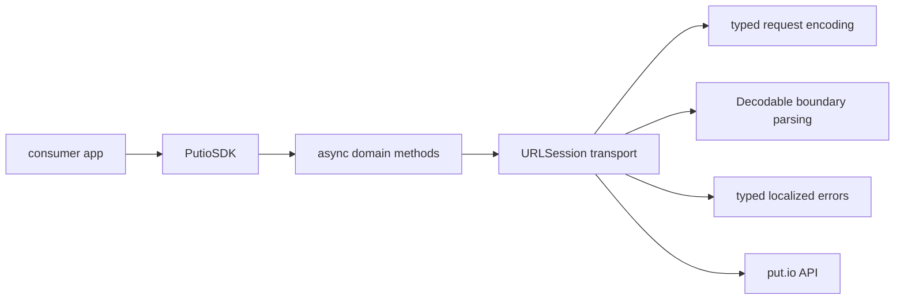

# Architecture

## System View

## Design Rules

- Native Swift concurrency and native `URLSession`; no third-party networking
  dependency and no completion-handler wrappers.
- Network methods are `async throws`; URL builders, OAuth state, callback
  parsing, and token accessors are synchronous.
- Parse responses at the boundary with `Decodable`, and encode query and body
  values through SDK-owned typed primitives, not untyped parameter bags.
- Keep media URL construction in the SDK. Callers pass the account download
  token, never the OAuth token, and the returned URLs stay bearer-sensitive.
- Tolerate unknown backend strings instead of crashing.
- `config` is an app-owned document: the app declares its `Codable` shape and
  keys, and the SDK never hardcodes them.

Each API domain lives in its own folder under
[`PutioSDK/Classes`](../PutioSDK/Classes).

## Swift Concurrency Posture

The `PutioSDK` target enables `NonisolatedNonsendingByDefault`, so public async
methods run on the caller's actor instead of sending the mutable client and
models to a generic executor
([SE-0461](https://github.com/swiftlang/swift-evolution/blob/main/proposals/0461-async-function-isolation.md)).

Consumers:

- Keep each `PutioSDK` instance on one actor, such as an `@MainActor` model or
  a session actor.
- Create and mutate `config`, `delegate`, and the mutable response models on
  that actor; never capture them in detached or concurrent tasks.
- Pass only the explicitly `Sendable` inputs and immutable results between
  actors. Call an actor-owned SDK through actor methods instead of marking the
  client `@unchecked Sendable`.
- Give types passed to `getConfig(as:)` and `getConfigValue(key:as:)` a
  `nonisolated` `Decodable` conformance. The SDK decodes them off the caller's
  actor and requires `SendableMetatype`, and `MainActor` default isolation
  would otherwise infer an isolated conformance.

Query, update, error, and immutable transfer value types declare `Sendable`.
The older `open` class models stay mutable and non-`Sendable`, and the mutable
`PutioClearDataOptionKeys` global stays outside the audited surface: changing
either breaks the API and needs a major release.

### Internal transport isolation

`PutioSDK.request` ([PutioSDK.swift](../PutioSDK/Classes/PutioSDK.swift)) runs
on the caller's actor and snapshots `config` and `delegate` before it hands off
to the private `@concurrent` `perform` and `execute` helpers. Without
`@concurrent`, the transport would inherit the caller's isolation and run JSON
coding and `PutioSDKDelegate.onPutioSDKError` on a `@MainActor` consumer's main
thread.

- The `@concurrent` bodies, and helpers they call by name, never read
  `self.config`. The library compiles in Swift 5 mode, so such a read would
  race `setToken` and `clearToken` without a diagnostic.
  `scripts/check-transport-isolation.sh` enforces this in `make verify`.
- The delegate crosses the hop as a weak reference, so an in-flight request
  never extends its lifetime. A request reports its failure to the delegate set
  when it started, off the caller's actor.

`PutioSDKStrictConcurrencyTests` is a Swift 6 consumer target. It compiles every
domain from `@MainActor`, proves an actor-owned client, and requires the value
surface to be `Sendable`; `scripts/check-sendable-audit.sh` keeps that list in
step with every public `Sendable` type under `PutioSDK/Classes`. Public
`Sendable` conformances are API contracts
([migration guide](https://www.swift.org/migration/documentation/swift-6-concurrency-migration-guide/commonproblems/)),
so never add an unchecked one to a type that is not thread-safe.

[Package.swift](../Package.swift) uses tools version 6.2 and keeps the library
on language mode 5. `make verify` treats `IsolatedConformances` warnings as
errors; the manifest does not, because Xcode 26 passes a manifest
`treatWarning` to consumers with `-suppress-warnings` and fails their build.
